# 云枢 CloudHub · 企业一体化管理平台（前端演示）

多租户 SaaS 中后台的前端演示，覆盖 **CRM 客户关系 / OA 协同办公 / 财务中心 / 平台配置** 四个应用域，
共 **63 个功能页面（含跨域总览）+ 1 个承接页 + 1 个登录页**，全部为可交互的真实前端实现（Mock 数据，零后端依赖）。

> 设计基调：**商务科技风 · 简约大气 · 大厂风格**（Ant Design Pro 风格的信息密度与卡片化布局）。

[](LICENSE)
[](https://vuejs.org)
[](https://www.typescriptlang.org)
[](https://vite.dev)
[](https://www.antdv.com)

**在线演示**：<https://fenglaoban173.github.io/yunshu-cloudhub-saas/>（GitHub Actions 自动构建发布，每次推 `main` 都会更新）

---

## English Summary

**Yunshu CloudHub** is a front-end-only demo of a multi-tenant enterprise SaaS console.
It ships **63 functional pages** across four application domains — CRM, OA (collaborative
office), Finance and Platform Admin — plus a portal landing page and a login page.
There is **no backend**: all data is mocked, and the whole app runs from `npm run dev`.

What makes it more than a static mock-up:

- **Every button does something real.** No placeholder toasts anywhere. 176 declarative
  action rules cover all 174 distinct button names on the 48 config-driven list pages,
  executed by a single shared engine (`src/composables/useAction.ts`).
- **Batch actions on every list page.** Select rows and the toolbar switches into a batch
  mode — 113 batch action names, every one of them backed by an explicit rule.
- **Live data.** A Pinia store holds all records; creating, approving, converting and
  deleting really mutate the store and survive in-app navigation (they reset on refresh).
- **Charts are entry points.** ECharts drill-downs push deep-link filters into the target
  list page instead of ending at a dead tooltip.
- **Config-driven pages.** A new list page is a `PageDef` object in `src/mock/pages.ts`,
  not another hand-written Vue component.

**Stack:** Vue 3.5 · TypeScript 5.6 · Vite 6 · Ant Design Vue 4.2 · Pinia 2 · Vue Router 4 (hash) · ECharts 5

```bash
npm install
npm run dev      # http://127.0.0.1:5273
npm run build    # type check + production build
```

**Live demo:** <https://fenglaoban173.github.io/yunshu-cloudhub-saas/> — built and published
by GitHub Actions on every push to `main`.

**License:** MIT — see [LICENSE](LICENSE). Contributions welcome, see [CONTRIBUTING.md](CONTRIBUTING.md).

> ⚠️ **Trademark notice** — "CloudHub" and "云枢" are names in use by other companies
> (for example MuleSoft's CloudHub platform, and registered Chinese class-42 trademarks).
> This repository is an independent, unaffiliated demo; the name is used here for
> demonstration purposes only.

---

## 快速开始

```bash
npm install
npm run dev      # 开发服务，默认 http://127.0.0.1:5273
npm run build    # vue-tsc 类型检查 + 生产构建
npm run preview  # 预览构建产物
```

### 登录 → 承接页 → 选系统

```
登录页  ──►  承接页 /portal  ──►  选择应用  ──►  该应用的「工作台」
                                    │
                                    └── 侧栏只展示该应用域的菜单
```

承接页（`/portal`）是**全屏门户**，只列出当前角色被授权的应用；点击应用卡片即进入对应系统。
系统内顶栏提供**应用切换器**，可随时在已授权的应用之间跳转；侧栏首项「应用门户」可随时回到承接页。

### 应用域落地页约定

**每个应用域都有自己的「工作台」，且是该域的第一个菜单项、也是进入该域后的落地页。**
无论从哪条路径进入（承接页点卡片 / 顶栏应用切换器 / 直接输 URL / 侧栏点分组），落点一致：

| 应用域 | 落地路由 | 浏览器标签 | 工作台内容 |
| --- | --- | --- | --- |
| CRM 客户关系 | `/crm/dashboard` | CRM 工作台 | 管道健康度、团队业绩、重点商机与客户 |
| OA 协同办公 | `/oa/dashboard` | OA 工作台 | 审批量、待我审批、会议与公告、部门人员分布 |
| 财务中心 | `/finance/dashboard` | 财务工作台 | 收入成本与毛利、资金账户、期间任务、逾期应收 |
| 平台配置 | `/platform/dashboard` | 平台工作台 | 登录趋势、租户概览、操作日志、服务健康度 |

跨域的 `/dashboard` 叫**总览**（集团级跨应用视图），与应用内的「工作台」区分开。
工作台统一由 `src/config/apps.ts` 的 `entry` 字段指向，是应用域落地的唯一事实来源。

### 演示身份

登录页顶部「演示身份」下拉可直接切换身份（密码统一 `cloudhub2025`）。
**不同角色被授权的应用域不同**，因此登录后看到的承接页卡片与左侧菜单都会随之变化：

| 账号 | 用户 | 角色 | 可见应用域 | 演示要点 |
| --- | --- | --- | --- | --- |
| `admin@cloudhub.cn` | 苏念 | OS 管理员 | OA · 财务 · 平台配置 | **不含 CRM**，左侧无「CRM 客户关系」分组 |
| `chenmo@cloudhub.cn` | 陈墨 | 集团财务总监 | OA · 财务 | 财务视角 |
| `sales@cloudhub.cn` | 周砚 | 销售总监 | CRM · OA | 销售视角 |
| `super@cloudhub.cn` | 何见山 | 超级管理员 | CRM · OA · 财务 · 平台配置 | 全量菜单，与上面对比 |

| 项 | 值 |
| --- | --- |
| 租户 | 云枢科技集团（旗舰版 Enterprise） |

---

## 权限与菜单模型

侧边栏的可见性由三层过滤决定，前端对应关系如下：

| 层级 | 决定什么 | 前端位置 |
| --- | --- | --- |
| ① 租户订阅 | 这个租户买了哪些应用域 | `tenant_module`（后端） |
| ② 角色授权 | 角色能进哪些域、域内能看哪些菜单 | `role_app` / `role_menu`（后端） |
| ③ 用户 | 挂了哪些角色 | `sys_user_role`（后端） |

演示实现：

- `src/config/apps.ts` —— **应用域元数据**（编码 / 名称 / 图标 / 主题色 / 落地路由 `entry`），承接页、切换器共用
- `src/config/menu.ts` —— 菜单树（唯一菜单来源），`MenuNode.app` 标识归属应用域，`MenuNode.docTitle` 区分同名的工作台；
  `filterMenuByApps()` / `appOfPath()` / `flattenMenu()` 为权限工具函数
- `src/mock/users.ts` —— 演示身份 → 角色 → 应用域授权
- `src/stores/user.ts` —— `apps`（有权应用域）、`currentApp`（当前所在应用域）、`hasApp()`

**关键实现约定**

- **路由表全量静态注册**，不按权限裁剪 —— 否则直接输入 URL 或刷新无权页面会 404。
  真正的准入校验在路由守卫（`src/router/index.ts`）里：无权访问 → 提示并跳回承接页。
- **每个应用域的第一个子菜单是「工作台」**，分组路由 `/crm` `/oa` `/finance` `/platform` 会重定向到它；
  应用域的落地路由统一由 `apps.ts` 的 `entry` 提供。
- **侧栏按应用域裁剪**：只展示当前应用域的菜单分组 + 公共节点（总览、应用门户）。
- **页签按应用域隔离**：切换应用时自动关闭其它应用域的页签（公共页签保留）。
- **总览**是跨域视图，对所有登录用户可见；其中的快捷入口与卡片会按权限过滤，避免出现点不进去的按钮。

---

## 页面清单

### 承接页（1）
`/portal` 应用门户 —— 深色 Hero（问候语 + 今日概览）、应用卡片（图标 / 名称 / 说明 / 关键指标）、
跨应用「待我处理」聚合表、最近访问快捷入口

### 总览（1）
`/dashboard` 总览 —— 跨域视图：KPI 卡片、经营概览图表、销售漏斗、我的待办、公告动态、系统健康度

### CRM 客户关系（15）
| 路由 | 页面 | 形态 |
| --- | --- | --- |
| `/crm/dashboard` | **工作台**（CRM 落地页） | 独立视图（漏斗 + 团队业绩 + 动态） |
| `/crm/kanban` | 商机看板 | 独立视图（五阶段拖拽看板） |
| `/crm/lead-pool` | 线索池 | 列表页 |
| `/crm/lead` | 线索管理 | 列表页 |
| `/crm/account` | 客户管理 | 列表页 |
| `/crm/account/360` | 客户 360 视图 | 独立视图（档案 + 商机 + 回款 + 动态时间轴） |
| `/crm/contact` | 联系人管理 | 列表页 |
| `/crm/opportunity` | 商机管理 | 列表页 |
| `/crm/quote` | 报价单 | 列表页 |
| `/crm/contract` | 合同管理 | 列表页 |
| `/crm/receipt` | 回款计划 | 列表页 |
| `/crm/follow` | 跟进记录 | 列表页 |
| `/crm/funnel` | 销售漏斗 | 独立视图（漏斗 + 转化率） |
| `/crm/target` | 销售目标 | 列表页 |
| `/crm/product` | 产品与定价 | 列表页 |

### OA 协同办公（17）
`/oa/dashboard` **工作台**（OA 落地页）· `/oa/todo` 待办中心（徽标 12）· `/oa/approval` 审批中心 ·
`/oa/flow` 流程模板 · `/oa/attendance` 考勤管理 · `/oa/leave` 请假管理 · `/oa/travel` 出差管理 ·
`/oa/overtime` 加班申请 · `/oa/expense` 费用报销 · `/oa/notice` 通知公告 · `/oa/meeting` 会议室与会议 ·
`/oa/knowledge` 知识库 · `/oa/org` 组织架构（独立视图）· `/oa/staff` 员工档案 · `/oa/seal` 印章管理 ·
`/oa/okr` 目标管理 OKR · `/oa/schedule` 日程安排

### 财务中心（18）
`/finance/dashboard` **工作台**（财务落地页）· `/finance/bookset` 账套管理 · `/finance/account` 会计科目 ·
`/finance/voucher` 凭证管理 · `/finance/voucher/new` 凭证录入（独立视图）· `/finance/gl` 总账明细 ·
`/finance/ar` 应收管理 · `/finance/ap` 应付管理 · `/finance/invoice` 发票管理 · `/finance/bank` 银行账户 ·
`/finance/flow` 银行流水 · `/finance/recon` 对账管理 · `/finance/asset` 固定资产 ·
`/finance/budget` 预算管理（独立视图）· `/finance/report` 财务报表（独立视图：资产负债表 / 利润表 / 现金流量表）·
`/finance/close` 期末结账 · `/finance/cashier` 出纳日记账 · `/finance/tax` 税务申报

### 平台配置（12）
`/platform/dashboard` **工作台**（平台落地页）· `/platform/user` 用户管理 · `/platform/role` 角色权限 ·
`/platform/dept` 部门管理 · `/platform/dict` 数据字典 · `/platform/number` 编号规则 ·
`/platform/tenant` 租户与套餐 · `/platform/message` 消息中心 · `/platform/log` 操作日志 ·
`/platform/login-log` 登录日志 · `/platform/config` 参数配置 · `/platform/api` 开放平台 API（独立视图）

---

## 技术栈

| 层 | 选型 |
| --- | --- |
| 框架 | Vue 3.5 + TypeScript 5.6 + Vite 6 |
| UI | Ant Design Vue 4.2（自定义 Design Token）+ @ant-design/icons-vue |
| 状态 | Pinia 2 |
| 路由 | Vue Router 4（hash 模式） |
| 图表 | ECharts 5 |

### 目录结构

```
src/
├─ config/
│  ├─ menu.ts           菜单树（唯一菜单来源，路由由其派生）+ 权限工具函数
│  ├─ apps.ts           应用域元数据（承接页 / 切换器共用）+ 落地路由 entry
│  └─ actionRules.ts    动作语义表（按钮名 → 语义 + 目标 + 字段 + 提示）
├─ mock/
│  ├─ pages.ts          页面定义（PageDef），驱动通用列表页
│  ├─ users.ts          演示身份与角色 → 应用域授权
│  ├─ portal.ts         承接页静态配置（最近访问快捷入口）
│  └─ crm.ts oa.ts finance.ts platform.ts base.ts
├─ layouts/BasicLayout 侧边栏（按应用域裁剪）+ 顶栏（含应用切换器）+ 多标签页
├─ router/index.ts      静态路由表 + 权限守卫
├─ stores/
│  ├─ user.ts           身份、角色、应用域授权、当前租户
│  ├─ data.ts           全局数据仓库（所有列表页共享一份）
│  ├─ ui.ts             全局浮层状态（新增/详情/预览/分配）
│  ├─ chrome.ts         外壳交互（通知/个人中心/租户/偏好/文档）
│  └─ tabs.ts           页签，按应用域隔离
├─ composables/
│  ├─ useAction.ts      动作执行器（全站按钮唯一入口）
│  └─ usePortal.ts      门户跨应用待办聚合（实时）
├─ views/
│  ├─ ListPage.vue      配置驱动的通用列表页（渲染 ~45 个页面）
│  ├─ portal/index.vue  承接页（全屏应用门户）
│  ├─ dashboard/        总览（跨域视图）
│  └─ crm/ oa/ finance/ platform/     独立视图，含各域「工作台」落地页
├─ components/
│  ├─ GlobalLayer.vue   全局浮层总装（挂在 App.vue）
│  ├─ RecordDrawer / DetailDrawer / PreviewDrawer / AssignModal
│  ├─ NoticePanel / ProfileModal / TenantModal / PrefsModal / DocModal
│  └─ AppIcon / BaseChart / QuickLinks
├─ utils/               export.ts（CSV 导出）· preview.ts（预览文档）· docs.ts（帮助与协议）· confirm.ts（二次确认弹窗，随路由回收）· drill.ts（图表下钻约定）
├─ styles/              tokens.css / global.css / antd.css
└─ theme.ts             Ant Design Token 覆盖
```

**页面实现方式**：约 45 个列表类页面由 `src/mock/pages.ts` 中的 `PageDef` 配置驱动，
统一由 `views/ListPage.vue` 渲染（KPI 卡 / 搜索区 / 工具栏 / 数据表格 / 分页 / 行操作）；
图表类、看板类、树形类页面为独立组件。
**四个应用域的工作台结构一致**：页头 + 常用功能快捷条（`components/QuickLinks.vue`）+ KPI 卡 +
图表区 + 列表区，并各自使用所属应用域的主题色。

---

## 交互层：每一个按钮都是真的

全站没有「（演示）」占位按钮。每个按钮点下去都会发生**可验证的事情** ——
改数据、开表单、出文件、跳页面。这靠三层共享能力实现：

### ① 动作语义表 + 统一执行器

`src/config/actionRules.ts` 把按钮名映射成**动作语义**，`src/composables/useAction.ts` 是唯一的执行器。
新增/修改/删除/审批/驳回/置状态/开关/分配/导出/导入/详情/转化/推进/通知/预览/跳转 —— 17 种语义，
**176 条规则**（含 44 条批量动作规则），覆盖 48 个列表页 **174 个不同的按钮名**，一个不漏；
认不出来的按钮名走关键字兜底
（`新建|新增|发起|登记|录入` → 新建，`审核|通过` → 审批，`分配|领取` → 分配，`预览|设计|拆解` → 预览）。

```ts
// src/config/actionRules.ts
export type ActionKind =
  | 'create' | 'edit' | 'remove' | 'approve' | 'reject' | 'setStatus'
  | 'toggle' | 'assign' | 'export' | 'import' | 'detail' | 'convert'
  | 'advance' | 'notify' | 'preview' | 'open' | 'custom'

导出: r('export'),
审批: r('approve'),
转客户: r('convert', { target: 'account' }),
置顶: r('toggle', { field: 'top', value: '是' }),
```

同名动作在不同页面语义不同，用**页面级覆盖**表达：

```ts
const pageOverrides = {
  ar:     { 核销: { kind: 'approve', field: 'status', value: '已核销' } },
  ap:     { 付款: { kind: 'setStatus', field: 'status', value: '已付款' } },
  invoice:{ 开具: { kind: 'setStatus', field: 'status', value: '已开具' } },
  notice: { 置顶: { kind: 'toggle', field: 'top', value: '是', value2: '否' } },
  flow:   { 启停: { kind: 'toggle', field: 'status', value: '启用', value2: '停用' } },
}
```

### ② 全局数据仓库（数据是活的）

`src/stores/data.ts` 在启动时深拷贝 `PageDef.data` 初始化，之后**所有页面的增删改都落在同一份仓库里**：

- 在审批中心通过一条待办 → OA 工作台「待我审批」和总览「我的待办」立刻少一条
- 核销一笔应收 → 财务工作台「应收余额」与门户「逾期应收」同步变化
- 新建商机 → CRM 工作台「在途商机」数量立刻 +1

刷新页面即恢复初始演示数据（无后端）。仓库提供 `rows / addRow / updateRow / patchRows / removeRows / nextId / nextCode / blankRow`。

**写回对齐**：列表页为了渲染行号会给每行克隆一份（`{ ...row, __key }`），直接改克隆对象是改不到仓库的。
`useAction.run()` 入口会用 `liveRow()` 按 id 把行换回仓库里的「活记录」，
所以审批 / 驳回 / 置状态 / 开关（置顶 · 启停）/ 阶段推进这类直接改字段的动作**真的会落到数据上**，
并立刻反映到页签计数、KPI 卡和其它页面。

**弹窗回收**：二次确认走 `src/utils/confirm.ts` 的 `confirmDialog()`，而不是原生 `Modal.confirm`。
命令式弹窗不随组件卸载消失，不回收的话来回切几次页面，body 上会叠出一层遮罩把界面挡住；
路由守卫 `afterEach` 会统一销毁还开着的确认框。

### ③ 外壳交互（顶栏 / 门户 / 登录）

`src/stores/chrome.ts` 承载跨页面复用的外壳浮层，偏好写入 `localStorage['ch_prefs']`：

| 入口 | 行为 |
| --- | --- |
| 顶栏铃铛 | 真实未读数（与消息中心同一份数据），可单条已读 / 全部已读，点条目跳转消息中心 |
| 个人中心 | 账号 / 部门 / 角色 / 租户 + 授权应用清单，修改密码带两次一致性与长度校验 |
| 切换租户 | 切换后顶栏、门户、偏好里的租户身份一起变，刷新后仍保留 |
| 偏好设置 | 表格密度（紧凑 / 默认 / 宽松，写 `<html data-density>`）、通知自动已读、**登录落地页** |
| 登录落地页 | 「应用门户」→ `/portal`；「上次所在应用」→ 该应用域的工作台（`user.lastAppEntry`，登录前自动记住 `ch_last_app`） |
| 帮助文档 / 页脚协议 | 打开全局文档弹窗，展示帮助、服务协议、隐私政策、安全白皮书正文 |

### ④ 全局浮层（挂一次，到处能开）

`src/components/GlobalLayer.vue` 挂在 `App.vue` 下，承接页这种没有控制台外壳的页面同样能用：

| 浮层 | 组件 | 能力 |
| --- | --- | --- |
| 新增 / 编辑 | `RecordDrawer.vue` | 按 `PageDef.columns` 自动生成表单（金额→数字框、状态→下拉、日期→日期选择器），提交写入仓库 |
| 详情 | `DetailDrawer.vue` | 只读字段清单 + 一键转编辑 |
| 预览 | `PreviewDrawer.vue` | 简报 / 流程设计 / 权限树 / 拆解 KR / 三单匹配 等富文本区块（kv / 表格 / 清单） |
| 分配 | `AssignModal.vue` | 选责任人 / 角色 / 部门，候选项来自真实人员与组织数据 |
| 通知面板 | `NoticePanel.vue` | 未读数、单条已读、全部已读，与消息中心同一份数据 |
| 个人中心 / 切换租户 / 偏好设置 / 文档 | `ProfileModal` `TenantModal` `PrefsModal` `DocModal` | 身份与授权范围展示、改密码校验、租户切换（刷新后保留）、表格密度 / 自动已读 / 登录落地页 |

导出走 `src/utils/export.ts`：**真实 CSV 文件**（带 UTF-8 BOM，Excel 双击不乱码），分享链接走剪贴板。

### 独立视图的交互

看板 / 客户 360 / 销售漏斗 / 待办中心 / 组织架构 / 考勤 / 凭证录入 / 预算 / 报表 / 开放平台 等独立视图
不复用列表页，但同样接共享层：读写仓库、开全局浮窗、导出真实文件、走同一套动作语义。

### ⑤ 图表下钻 + 深链筛选（图表也是入口）

工作台上的图表不是装饰：**点图表元素 → 带着条件跳到明细页**，
跳过去看到的就是被点中的那部分数据，而不是一屏全量。

约定统一在 `src/utils/drill.ts`：

```ts
chartName(p)          // 取被点元素的名称（分类轴标签 / 扇区名）
chartSeries(p)        // 取系列名（堆叠柱里点中的具体是哪个系列）
drillTo(router, path, query, tip)   // 跳明细页并带上筛选条件
```

已接入下钻的图表：

| 页面 | 图表 | 点什么 | 跳到哪 |
| --- | --- | --- | --- |
| `/dashboard` 总览 | 经营概览 / 销售漏斗 | 任意数据点 / 漏斗层 | `/crm/target` · `/crm/funnel` |
| `/crm/dashboard` | 月度目标 / 线索来源 | 柱子 / 来源扇区 | `/crm/target` · `/crm/lead?keyword=` |
| `/crm/funnel` | 阶段漏斗 / 来源 / 负责人 | 漏斗层 / 扇区 / 柱 | **页内联动筛选**（商机明细表 + 筛选标签） |
| `/oa/dashboard` | 周审批量 / 审批类型 | 堆叠柱 / 扇区 | `/oa/approval?status=` · `?type=` |
| `/finance/dashboard` | 收入成本 / 成本结构 | 柱 / 扇区 | `/finance/report?tab=利润表`（+`&focus=` 高亮行） |
| `/finance/budget` | 部门预算 | 柱 | **页内筛选**（表格按部门过滤 + 部门标签） |
| `/finance/report` | 近 6 期收入成本 | 折线数据点 | **切到利润表并切换会计期间** |
| `/platform/dashboard` | 登录趋势 / 套餐分布 | 折线 / 扇区 | `/platform/login-log?result=` · `/platform/tenant?plan=` |

**深链筛选**由通用列表页 `views/ListPage.vue` 统一承接：

- 地址栏里的查询条件直接落到搜索框上（如 `/oa/approval?status=已通过`）
- 搜索区上方显示「链接筛选」标签，**单个可删、可一键清空**（清空会同步改写地址栏）
- 页签与筛选条件是「与」的关系：带着链接条件进来时页签自动放宽到「全部」，
  否则「待我审批 × 状态=已通过」会筛出 0 条，等于白跳一趟

**图表点击的两处工程处理**（`components/BaseChart.vue`）：

- 折线系列开启 `triggerLineEvent` —— 否则只能点中数据点、点线段没反应；
  同时折线常常盖在柱子上（如「目标」柱 + 「实际」面积线），不开这个开关，面积会吞掉柱子的点击
- 点在**线段**上时 ECharts 不给 `dataIndex`，组件用 `convertFromPixel` 按横坐标反查**最近的类目**补上，
  于是「点哪个月就切到哪个月」在点数据点和点线段两种情况下都成立

### ⑥ 交互回归审计（全站按钮逐个点过）

不靠「读代码觉得没问题」，而是**在浏览器里逐个点**：脚本遍历每个页面的每一个可点元素
（按钮 / 标签页 / 分页 / 排序表头 / 行操作 / 工具栏项 / 单选组 / 图表），
逐个点击并对比点击前后的 DOM、toast、抽屉、弹窗、路由与输入框取值，
16 个独立视图页共 **518 次点击**，控制台 **0 报错**，无「点了没反应」的控件。

同时做了一遍**静态审计**（脚本扫描 + 人工核对）：

| 检查项 | 结论 |
| --- | --- |
| 所有 `@click` / `@change` / `@ok` / `@close` / `@point-click` | 都能解析到有实现的函数，无空函数体 |
| `（演示）` / `TODO` 占位文案 | 0 处 |
| 动作执行器 17 种语义 + 7 个自定义处理器 | 全部有分支实现；176 条规则覆盖全站 174 个按钮名 |
| 「只写不读」的绑定（装饰性控件） | 修掉 3 处（下表） |

审计中发现并修复的 3 个真实缺陷：

| 缺陷 | 现象 | 修复 |
| --- | --- | --- |
| 总览「时间范围」是装饰 | 选「近 6 个月 / 本季度」，图表与合计纹丝不动 | 单选绑定 `range`，`rangeMonths` 按区间截取月度序列，图表与合计**同源**；卡片内补「统计区间」口径行（`.chart-note`） |
| 凭证录入「账套」被丢弃 | 表单里有账套下拉，保存后凭证上没有账套字段 | 选项改为读「账套管理」中**使用中**的账套；`collectPayload()` 落 `bookset`、`loadVoucher()` 回填；凭证列表补「账套」列与筛选项 |
| CRM 工作台 KPI 写死 | 在途商机 / 赢单率 / 线索转化率是常量，别处改数据这里不动 | 改读实时仓库（`data.rows('opportunity' / 'lead')`）；口径与商机看板一致：在途 = 阶段未到「合同签署」，赢单率 = 已成交 / 全部商机 |

**审计中发现但确认无需改动的**：Ant Design Vue 的分页、标签页、单选组在重复点击时本来就该保持选中态；
数字输入框的步进按钮需要完整的 `mousedown → mouseup → click` 事件序列，脚本用 `el.click()` 打不到；
`disabled` 按钮不触发任何事件属于正确行为 —— 这些都不是缺陷。

### ⑦ 批量动作（工具栏切换模式）

前面 48 个列表页都有勾选框，却**没有一个能对勾选后的行做什么** —— 勾选只是摆设。
现在每个列表页都配了批量动作，勾选后工具栏整行切换成批量模式（Ant Design Pro 惯例，不额外占一行）：

```
未勾选   [批量导入] [刷新公海]                              [密度][刷新][导出]
已勾选   已选 3 项  [批量分配][批量退回公海][批量导出] 取消选择 [更多 ▾]  [密度][刷新][导出]
```

- **未勾选** → 页面级动作（导入、刷新公海、同步至账套、自动匹配……）
- **已勾选** → 同一行切换成「已选 N 项 + 批量动作 + 取消选择」；页面级动作收进「更多」下拉，勾选期间也点得到
- 批量动作写在 `PageDef.batchActions`（48 个页面全配），与页面级动作 `toolbar` 分开

**规则层**：批量动作全部带 `needSelect` 语义 —— 没勾选就点不到，勾了才对选中行生效。
新增 44 条批量规则（`批量导出 / 批量分配 / 批量转商机 / 批量生成应收 / 批量核销 / 批量折旧 / 批量结账 / 批量开通 / 批量催办 / 批量标记关键 / 批量调整部门 / 批量重置密码 / 批量同步至账套`……），
规则里补了 `verb`（确认框标题与成功提示里的动词，如「置顶」「下架」「开具」）与 `entity`（对象名，如「应收单」「会计期间」）。
`inferRule` 也认「批量X」：先按 `X` 的语义推断，再补上 `needSelect` 兜底。
48 个页面的 113 个批量动作名**全部有显式规则**，不依赖兜底推断。

**执行器的多行语义**（`composables/useAction.ts`）：

| 语义 | 批量行为 |
| --- | --- |
| `export` | 只导勾选的那些行（页面级「导出」仍导当前筛选结果集） |
| `approve` / `reject` / `setStatus` | 逐条写状态，只弹一次汇总提示（`已核销 12 条应收单`） |
| `toggle` | 逐条切换（置顶 / 启停） |
| `advance` | 逐条推进一个阶段，汇总一次 |
| `convert` | 逐条生成目标单据，缺必要字段的跳过并在提示里说明 |
| `assign` | 选一次人，分配给所有选中行 |
| `notify` | 每条生成一条站内消息 + 一条汇总提示 |
| `custom` | 逐条执行（退回公海 / 计提折旧 / 自动匹配核销 / 恢复参数默认值） |
| `remove` | 一次确认，删掉全部选中行 |

**顺带修掉的数据层问题**：

- 行唯一键统一（`rowKeyOf`）：勾选状态与行数据用同一把钥匙 —— 原先总账明细没有 `id`，勾上根本选不中
- `patchRows` / `removeRows` 认 `code`（会计科目以编码作主键，之前批量改不到）
- `addRow` 给以 `code` 为主键的页面续**编码**而不是续 id：会计科目续 `6603`、凭证续 `记-0039`，
  沿用既有编码的格式（`nextCode`），不再往编码列里塞一个随机 id；导入时同步重新编号，不复制来源编码
- `uniqueKey` 兜底：编号与现有记录撞车时往后加，避免同一秒内新建两条记录拿到同一个主键

**批量化之后暴露出来的 5 个真实缺陷**（逐个点出来、再逐个修掉）：

| 缺陷 | 现象 | 修复 |
| --- | --- | --- |
| 动词被状态值带偏 | 银行流水「批量核销」的确认框标题是「确认**是**？」——动词是从 `value: '是'` 推导出来的 | 规则里显式写的 `verb` 优先，状态值只在没有 `verb` 时用来推导；标题回到「确认核销？」 |
| 状态写错列 | `approve` 一律往「承载状态的列」写，银行流水的 `reconciled`（已对账）根本没被写到状态列上 | `applyStatus` 优先写规则声明的 `field`；没有该列才回退 |
| 批量转化整批跳过 | 「批量付款申请」「批量用印」「批量生成凭证」都提示「已生成 **0** 条，10 条缺少必要字段已跳过」 | 必填判定原先取「目标页第一个非 id 列」——凭证页取到 `code`、审批页取到 `type`，预填从来填不上；改为**主字段集合**判定，并补全别名表与默认值（日期 / 期间 / 账套 / 来源 / 制单人） |
| 状态跟着来源跑 | 来源是「审批中」的报销单，转出来的凭证状态也是「审批中」 | 转化时不搬来源的 `status`，目标页用自己的初始状态；规则可用 `preset` 显式指定（如用印申请固定「审批中」） |
| 同步账套没命中行 | 「批量同步至账套」提示「已同步 **0** 个科目」 | 会计科目以 `code` 作主键，`r.id` 是空的 —— 改用 `r.id ?? r.code`；并给科目表补「最近同步」列，同步结果看得见 |

规则里新增的 `preset` 字段（转化时固定写入的值，支持 `@amount` / `@user` / `@today` 占位），
让「付款凭证 = 贷方有金额、借方为 0」「用印申请 = 类型合同用印 + 状态审批中」这类业务规则写在规则表里，而不是散落在执行器中。

### ⑧ 筛选与状态标签的真实性

审计还发现两类「看得见、点不动」的问题，一并修掉：

- **19 个空下拉**：筛选项写成 `options: [...]` 的地方有 19 处是空的，点开没得选。
  改成 `optsOf(rows, key)` —— 直接从数据里推导取值，筛选项和数据永远对得上。
- **10 个页面状态标签全是灰的**：通用状态字典 `smStatus` 里没有各自的取值（合同「履约中」、发票「待认证」、客户「洽谈中」……），
  于是状态标签落回灰色默认样式，看不出状态语义。给这 10 个页面各配了一份字典
  （`smLeadPool / smLead / smAccount / smContract / smProduct / smBookset / smInvoice / smBank / smSysUser / smFinAccount`）。
- **输入框的搜索范围**：具名字段（负责人 / 申请人 / 客户 / 摘要……）原先搜的是整行，
  在「负责人」里输「陈墨」，客户名里带「陈墨」的记录也会被捞出来。现在只有「关键词」搜整行，具名字段只搜自己那一列。
- **两个语义错位的按钮**：线索池「领取」原来只弹一句 toast，表格里什么都没变（这张表甚至没有「负责人」列）——
  改成挂上负责人并置为「已锁定」，并补了「负责人」列；账套「结账」原来把「已结账」写进「状态」列，
  可状态列表示的是账套的启用/停用 —— 改成关掉当前会计期间、期间推进到下月。
- **是/否字段存了布尔值**：角色「内置」、参数「可编辑」的数据里存的是 `true/false`，
  标签字典是「是/否」，渲染出来是 `true` —— 统一成「是/否」字符串（与联系人「关键人」、公告「置顶」一致）。
- **账套会计期间全都一样**：5 个账套的期间都是 `2025-10`，期间列排不了序也看不出结账进度 ——
  改成各账套进度不同（`2025-10 / 2025-09 / 2025-10 / 2025-06 / 2025-08`）。

### ⑨ 批量动作的验证结果

批量动作不是「加了按钮就算完」，48 个页面逐个点过：

| 检查项 | 结论 |
| --- | --- |
| 工具栏切换 | 48 个页面勾选后都切成批量模式（显示「已选 N 项 + 批量按钮 + 取消选择」），取消后 48 个都回到原样 |
| 批量动作按钮 | 48 页共 113 个批量动作名，**全部有显式规则**（不走兜底推断） |
| 二次确认类动作 | 42 个带确认框的批量动作逐个确认执行，动词、条数、落库字段都对 |
| 破坏性动作 | 「批量删除」的确认框是危险态（红色按钮），确认后消息真的少了 10 条 |
| 分配弹窗 | 选一次人 → 选中行的归属字段全部改掉（`已分配给「云枢科技集团」，共 10 条`，表格里同步可见） |
| 转化类动作 | 付款申请 / 生成凭证 / 用印生成的记录能在目标页看到，且字段是「像样的」单据（期间、账套、摘要、借贷方、制单人都有值） |
| 控制台 | 全程 **0 报错** |

**Ant Design Vue 4.2 的确认框在 `.ant-modal-confirm-btns` 里**（不是 `.ant-modal-footer` / `.ant-modal-btns`），
`okType: 'danger'` 的按钮 class 是 `.ant-btn-dangerous` 而不是 `.ant-btn-primary` ——
自动化脚本按老经验找按钮会全部找不到，这是这轮验证里踩得最深的坑。

---

## 设计规范

- **主色** `#165DFF`；成功 `#00B42A`、警告 `#FF7D00`、危险 `#F53F3F`
- **应用域配色** CRM 蓝 `#165DFF` · OA 绿 `#00B42A` · 财务橙 `#FF7D00` · 平台紫 `#722ED1`
  —— 承接页卡片、顶栏切换器图标、各域工作台的主色（图表 / 快捷条 / KPI 图标）统一取所属域配色
- **圆角** 卡片 8px / 控件 6px / 标签 4px
- **间距** 4px 栅格（4 / 8 / 12 / 16 / 20 / 24）
- **字体** PingFang SC / HarmonyOS Sans SC / Microsoft YaHei
- **金额与数字** 统一 `tabular-nums` 等宽数字，右对齐

Token 同时落地在三处：`src/styles/tokens.css`（CSS 变量）、`src/theme.ts`（Ant Design Token）、
`src/styles/antd.css`（Ant Design Vue 4 无法通过 Token 定制的组件级样式）。

---

## 截图

图片在 `docs/screenshots/`。

### 登录与门户

| 登录页 | 承接页（应用门户） |
| --- | --- |
| 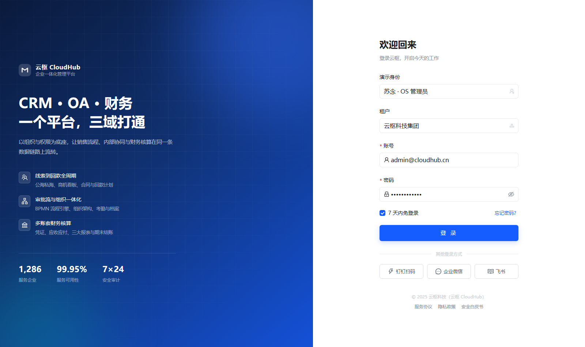 | 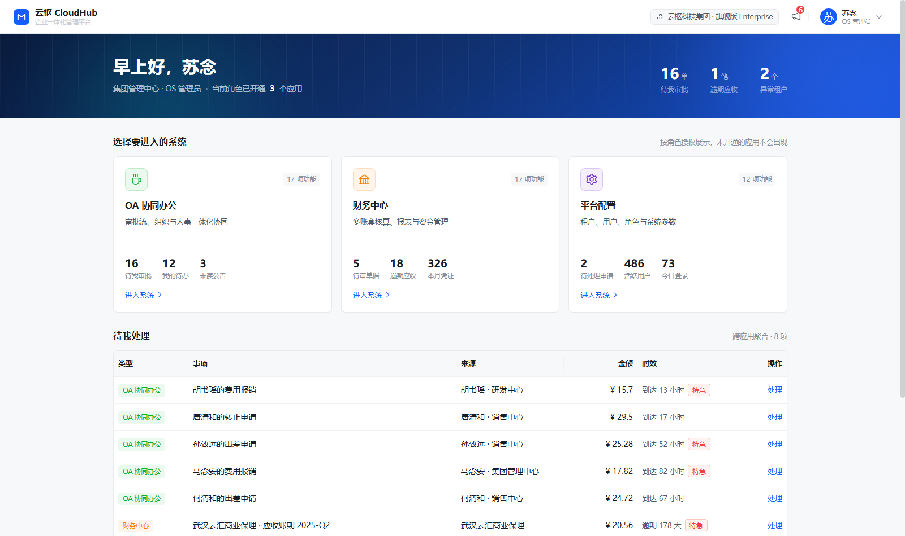 |

### 跨域总览与外壳

| 总览 | 应用切换器 |
| --- | --- |
| 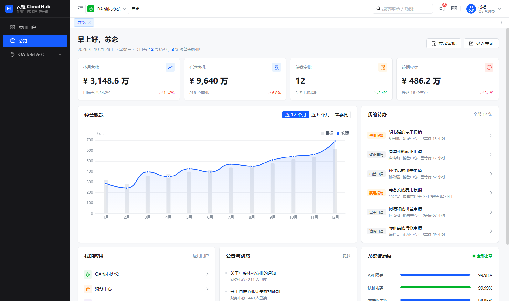 | 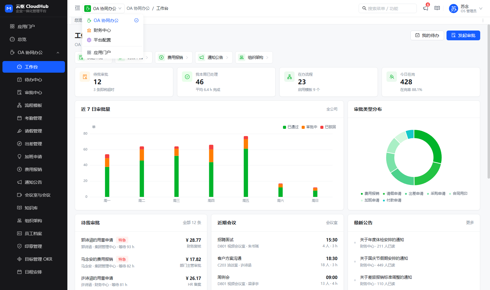 |

### CRM 客户关系

| CRM 工作台 | 商机看板 | 客户 360° |
| --- | --- | --- |
| 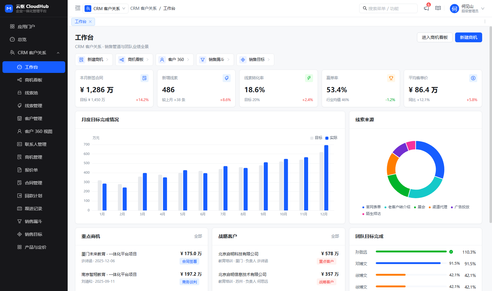 | 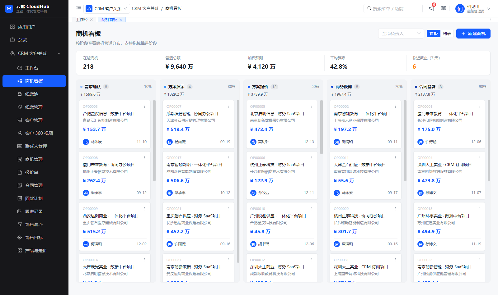 | 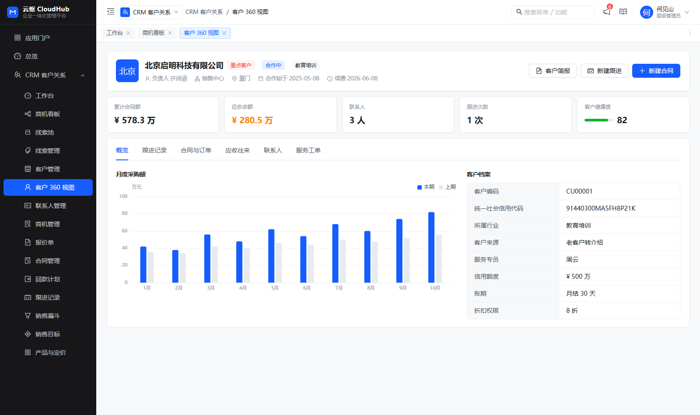 |

### OA 协同办公

| OA 工作台 | 审批中心 | 考勤 |
| --- | --- | --- |
| 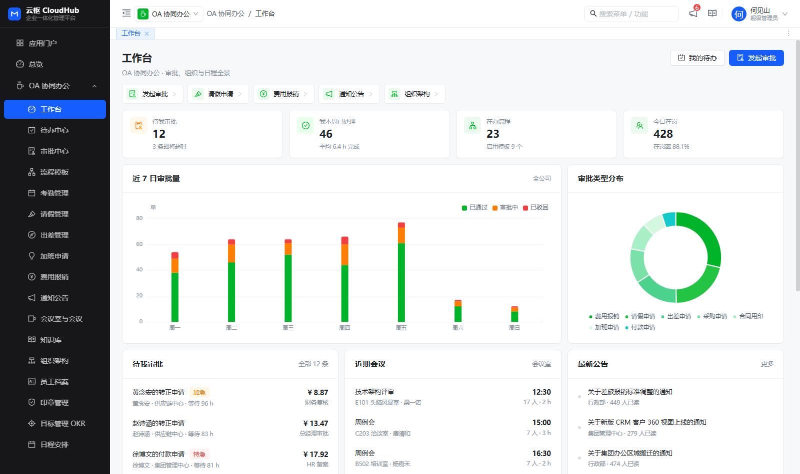 | 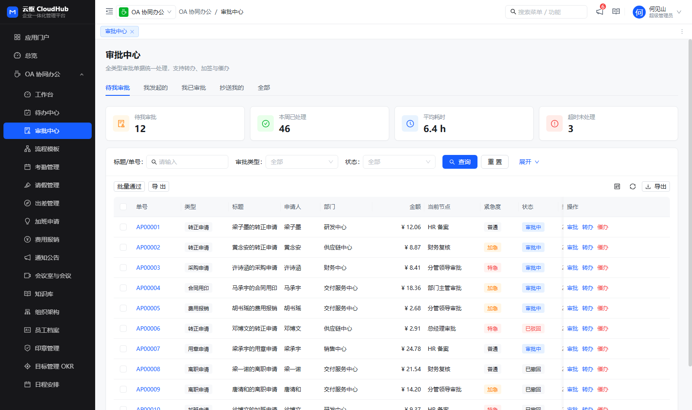 | 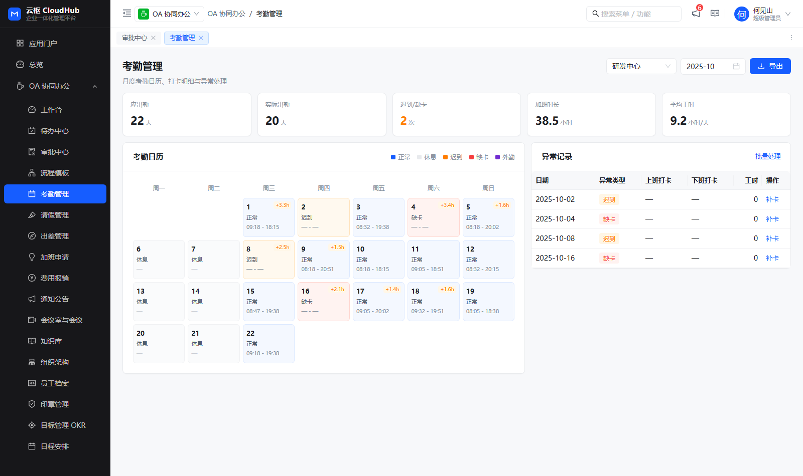 |

### 财务中心

| 财务工作台 | 凭证录入 | 报表 |
| --- | --- | --- |
| 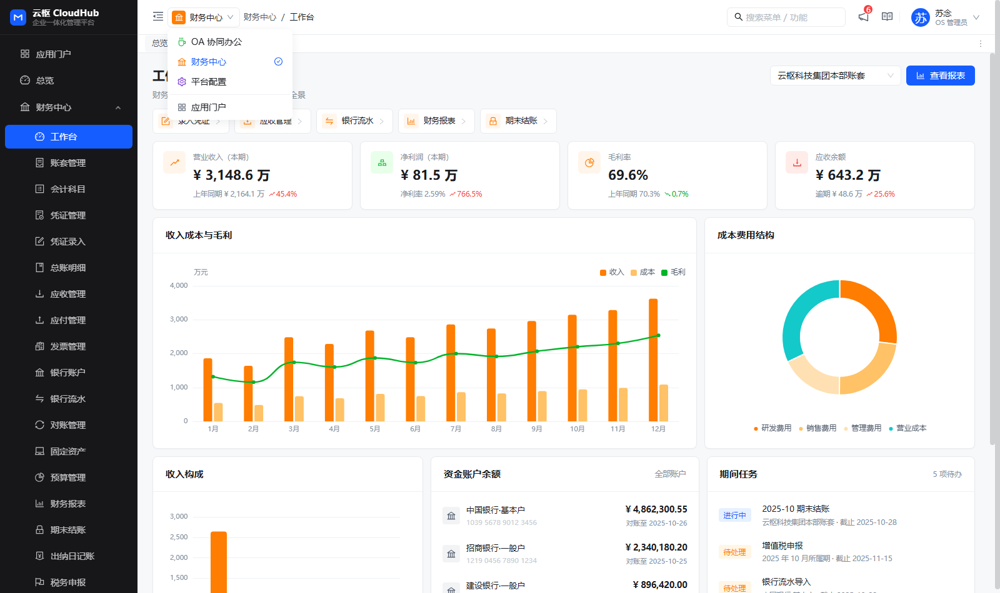 | 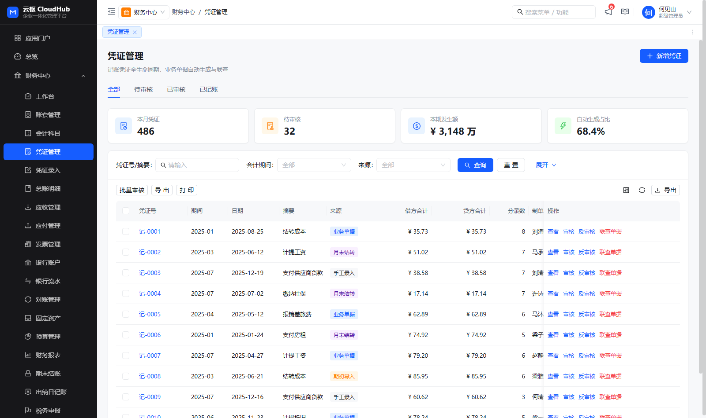 | 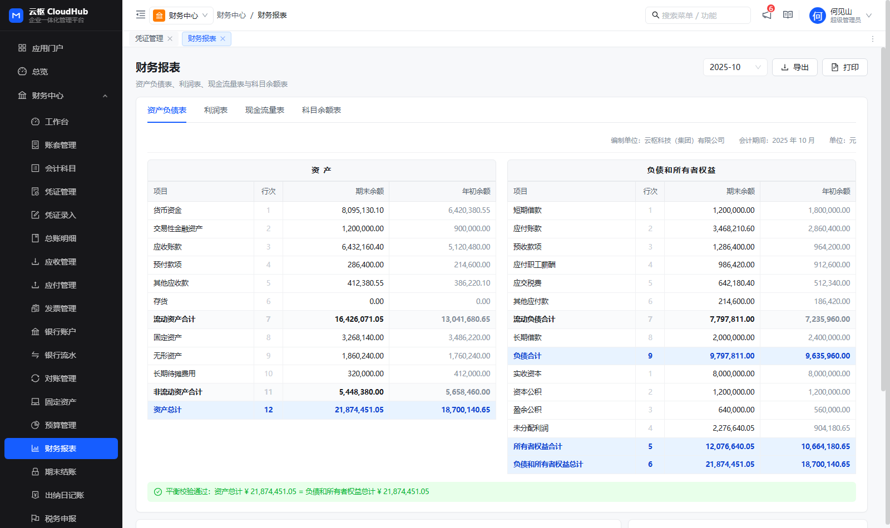 |

### 平台配置

| 平台工作台 | 租户管理 |
| --- | --- |
| 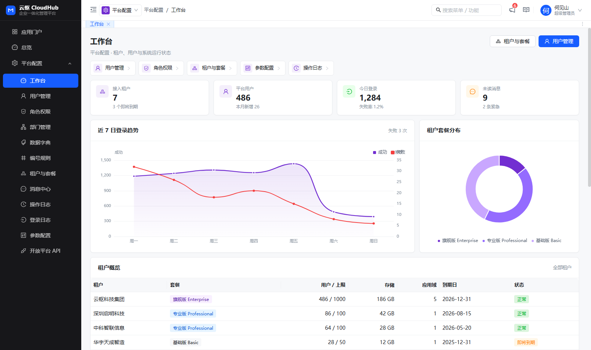 | 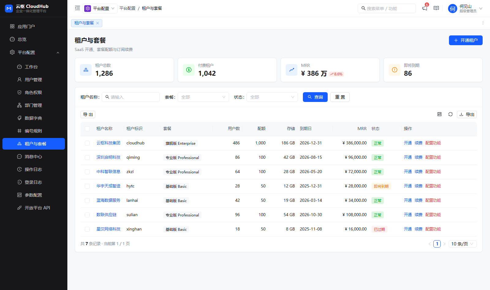 |

---

## 已知说明

- 全部数据为前端 Mock，无后端接口；登录仅做前端状态与本地 token 模拟。
- 权限为前端模拟：身份信息存在 `localStorage`，生产环境应由后端在登录响应中返回 `apps` 与 `perms`。
- 演示数据是 2025 年的静态时间线：**新生成的单据落在演示数据的最新会计期间（2025-10）**，而不是真实当天，
  否则新凭证会挂在一个数据里根本不存在的月份上（期间筛选也筛不出来）。
- 批量动作：48 个列表页都配了批量动作；操作日志 / 登录日志只留「批量导出」——
  审计日志不该被批量改写或删除。
- `npm run dev` 默认端口 5273（`vite.config.ts`）。若端口被占用，Vite 会自动顺延。
- **ECharts 5 有一条 moderate 级别的 XSS 通告**（[GHSA-fgmj-fm8m-jvvx](https://github.com/advisories/GHSA-fgmj-fm8m-jvvx)，
  影响 `< 6.1.0`）。修复需升级到 ECharts 6，属破坏性变更，本次未动；
  演示项目不渲染用户可控的富文本，风险有限。
- 本项目没有单测框架，回归依赖「静态审计脚本 + 浏览器探针」，
  见 [`scripts/verify/README.md`](scripts/verify/README.md) 与 `npm run verify:static`。

---

## 参与共建

- 贡献指南：[CONTRIBUTING.md](CONTRIBUTING.md)
- 行为准则：[CODE_OF_CONDUCT.md](CODE_OF_CONDUCT.md)
- 安全策略：[SECURITY.md](SECURITY.md)
- 问题反馈：[Issues](https://github.com/fenglaoban173/yunshu-cloudhub-saas/issues)

## 许可证

[MIT](LICENSE) © 2026 fenglaoban173
